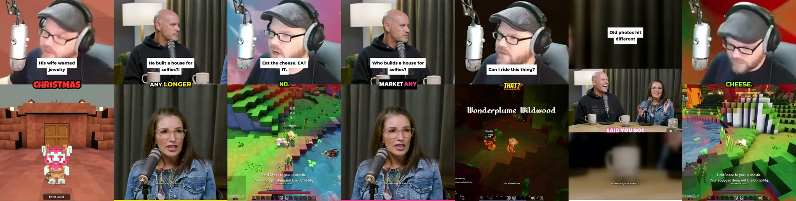
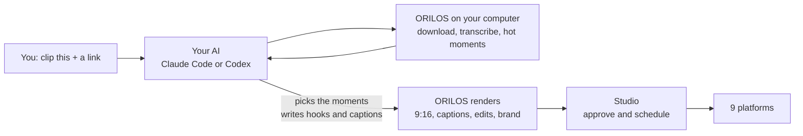
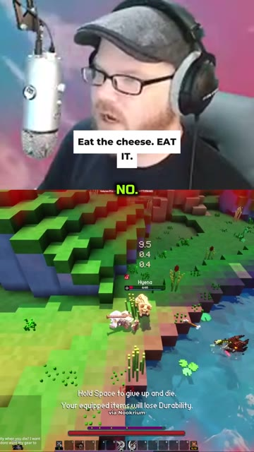
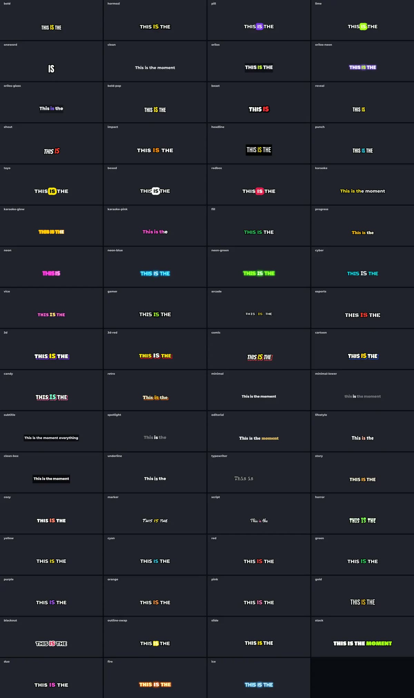
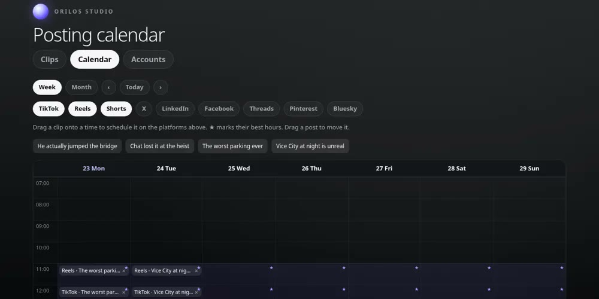

<p align="center">
  
</p>

<h1 align="center">ORILOS</h1>

<p align="center"><b>Long in. Short out.</b></p>

<p align="center">
  Paste a link into Claude Code or Codex. Get captioned, hooked, vertical shorts, ready to post.<br>
  Free. No AI key. On your own computer.
</p>

<p align="center">
  <a href="https://orilos.pages.dev"></a>
  <a href="https://orilos.pages.dev/docs"></a>
  <a href="https://orilos.pages.dev/docs/connect"></a>
  
</p>

<p align="center">
  &nbsp;
  &nbsp;
  &nbsp;
  &nbsp;
  &nbsp;
  &nbsp;
  &nbsp;
  &nbsp;
  
</p>

<p align="center">
  
</p>

<p align="center"><sub>Real ORILOS output. Sources: Veloren gameplay by Nookrium (CC BY) and "Winning Conversations" by Heritage of Faith CC (CC BY).</sub></p>

---

## What it does

You tell the AI you already use: *"clip this"* and a link. ORILOS does the rest.

| | |
|---|---|
| **Finds the moments people loved** | YouTube's most replayed graph, chat explosions, the clips viewers made, the loudest seconds, and every word said. |
| **Frames for 9:16** | Follows the speaker, stacks a facecam over gameplay, or fits a wide shot. Shot by shot. |
| **Captions every word** | 67 caption looks. Any script: Hindi, Arabic, Chinese, Japanese, Korean, Thai, Russian and more. |
| **Edits like a pro** | Jump cuts, punch-in zooms, lit keywords, sound hits, a progress bar, all inside each app's safe zone. |
| **Speaks** | A spoken hook in 53 languages, with free voices that run offline. |
| **Your brand** | Your logo, colours and font on every clip. Never an ORILOS watermark. |
| **Posts everywhere** | TikTok, Reels, Shorts, X, LinkedIn, Facebook, Threads, Pinterest and Bluesky. Now, or at each platform's best hours. |
| **Autopilot** | Watches your Twitch, Kick or YouTube channel and clips every stream while you sleep. |
| **Studio** | A private page on your computer to watch, approve, edit and drag clips onto a calendar. |

## How it works



Your AI is the creative director. ORILOS is its editing suite. Your videos, clips and keys never leave your computer.

<table>
  <tr>
    <td width="34%" valign="top"></td>
    <td valign="top">
      
      <br><br>
      
    </td>
  </tr>
</table>

## Get started

ORILOS plugs into Claude Code, Codex, Claude Desktop, Cursor, Windsurf and VS Code.

```bash
uvx orilos-mcp install
```

Then, in your AI app:

```text
clip this https://www.youtube.com/watch?v=...
```

In Claude Code you can also add it as a plugin from this repository:

```text
/plugin marketplace add Aaditya1273/ORILOS
/plugin install orilos@orilos
```

> **Release status:** the ORILOS package is being published. Until it is live, the install command above will not resolve. Watch this repository for the release.

Full guide: **[orilos.pages.dev/docs](https://orilos.pages.dev/docs)**

## This repository

The public home of ORILOS: the website, the docs and the Claude Code plugin.

| Path | What |
|---|---|
| `src/landing/` | The landing page at `/` |
| `src/docs/` | The docs at `/docs`: content, search and the tools reference |
| `src/ui/`, `src/lib/` | The ORILOS web app at `/app` (BYOK, runs in your browser) |
| `src/theme.css` | Brand tokens: black, white and hot pink, Inter Tight, Inter and JetBrains Mono |
| `public/` | Clips, images, logos and the mascot |
| `.claude-plugin/`, `plugin/` | The Claude Code plugin marketplace |
| `scripts/reel.sh` | Rebuilds the landing clip reel from finished clips |

Built with React 19, TypeScript and Vite. No backend.

```bash
npm install
npm run dev       # local site at http://localhost:5173
npm test          # unit tests
npm run build     # production build in dist/
```

The site is deployed to Cloudflare Pages (`orilos.pages.dev`). Security and cache headers live in `public/_headers`.

## Credits

- Demo clips made by ORILOS from **Veloren gameplay by Nookrium** and **"Winning Conversations" by Heritage of Faith CC**, both licensed CC BY.
- Miami night photo by **Sunira Moses** on Unsplash.
- Fonts: Inter, Inter Tight and JetBrains Mono (SIL Open Font License).
- Platform names and logos are trademarks of their owners and are used only to show where ORILOS can post.
- ORILOS is not affiliated with, endorsed or sponsored by Rockstar Games or Take-Two Interactive. Grand Theft Auto and GTA VI are their trademarks.

## Licence

Copyright (c) 2026 ORILOS. All rights reserved.
